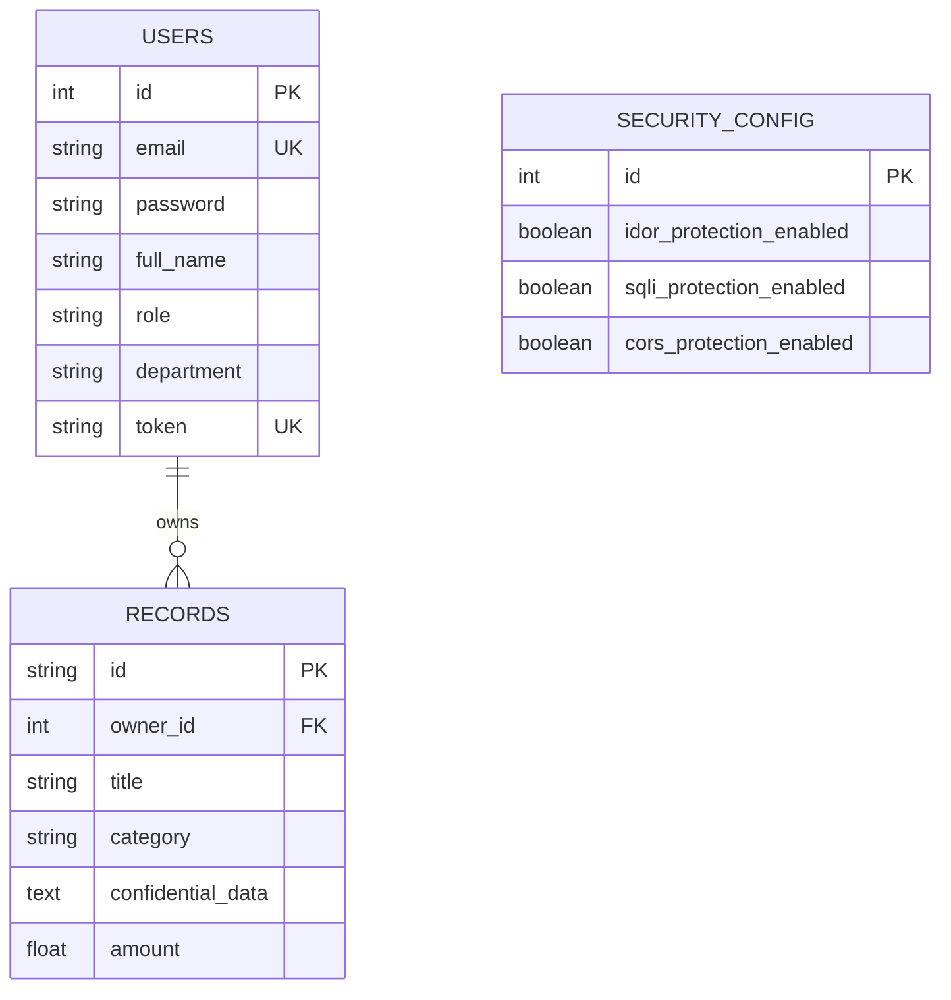

# Data Model & Schema Specification: HawkScan & ApexPortal

This document details the relational data structures, schemas, and persistence models utilized across the ApexPortal target testbed (`target_app.db`) and HawkScan's vulnerability dossier model.

---

## 1. ApexPortal Relational Database (`target_app.db`)

The target application uses an SQLite database managed via SQLAlchemy declarative base models (`target_app/database.py`).

### Entity Relationship Diagram



### Table Specifications

#### `users` Table
Stores corporate employee accounts.
- `id` (INTEGER, PK): Unique identifier.
- `email` (VARCHAR, UK): Corporate login email (e.g. `alice@apex.local`, `bob@apex.local`).
- `password` (VARCHAR): Plaintext test password (`password123`).
- `full_name` (VARCHAR): Full employee name.
- `role` (VARCHAR): Role (`analyst`, `vp_strategy`).
- `department` (VARCHAR): Corporate division.
- `token` (VARCHAR, UK): Bearer session token.

#### `records` Table
Stores confidential corporate deal and acquisition portfolios (targeted by IDOR/BOLA).
- `id` (VARCHAR, PK): Record identifier (e.g. `REC-9001`, `REC-9002`).
- `owner_id` (INTEGER, FK -> `users.id`): Tenant owner ID.
- `title` (VARCHAR): Deal title.
- `category` (VARCHAR): Category (e.g. `M&A Financial`, `Infrastructure`).
- `confidential_data` (TEXT): High-sensitivity corporate information (e.g. wire transfer routing, deal valuations).
- `amount` (FLOAT): Transaction amount (e.g. `$42,500,000.00`).

#### `security_config` Table
Controls dynamic runtime vulnerability patching.
- `id` (INTEGER, PK): Single configuration row.
- `idor_protection_enabled` (BOOLEAN): When `true`, enforces `record.owner_id == current_user.id` (returns HTTP 403 on tenant mismatch).
- `sqli_protection_enabled` (BOOLEAN): When `true`, executes parameterized ORM queries instead of string concatenation.
- `cors_protection_enabled` (BOOLEAN): When `true`, restricts CORS origins to explicit localhost ports.

---

## 2. HawkScan Vulnerability Dossier Model

The pentest dossier is structured as follows:

```json
{
  "status": "COMPLETED",
  "metadata": {
    "scan_id": "hawkscan-86d11c41",
    "target_url": "http://127.0.0.1:8000",
    "repo_path": "target_app",
    "duration_seconds": 0.2,
    "status": "COMPLETED"
  },
  "summary": {
    "verified_vulnerabilities": 2,
    "discarded_false_positives": 1,
    "critical": 1,
    "high": 1,
    "medium": 0,
    "low": 0,
    "live_endpoints_count": 14,
    "static_routes_count": 12
  },
  "verified_vulnerabilities": [
    {
      "vulnerability_id": "HAWKSCAN-BOLA-001",
      "title": "Broken Object Level Authorization (IDOR / BOLA)",
      "severity": "CRITICAL",
      "cwe_id": "CWE-639",
      "owasp_category": "A01:2021-Broken Access Control",
      "target_endpoint": "/api/records/REC-9001",
      "http_method": "GET",
      "status": "VERIFIED_EXPLOIT",
      "description": "User Alice Johnson successfully retrieved confidential corporate acquisition records (REC-9001)...",
      "proof_of_concept": {
        "exploit_command": "curl -X GET 'http://127.0.0.1:8000/api/records/REC-9001' ...",
        "http_status": 200,
        "leaked_payload": { "id": "REC-9001", "owner_id": 2 },
        "evidence_summary": "Retrieved Record ID REC-9001 belonging to Owner ID 2."
      },
      "remediation": {
        "target_file": "target_app/routes/records.py",
        "guidance": "Enforce object-level tenancy checks (record.owner_id == current_user.id)..."
      }
    }
  ],
  "discarded_false_positives": [
    {
      "title": "Blocked IDOR Candidate",
      "reason": "Probe returned HTTP 403; did not achieve confirmed breach.",
      "status": "DISCARDED_FALSE_POSITIVE"
    }
  ],
  "attack_surface": {
    "total_routes": 12,
    "frameworks": ["FastAPI (Python)", "SQLAlchemy ORM"],
    "public_endpoints": [ ... ],
    "authenticated_endpoints": [ ... ],
    "object_endpoints": [ ... ],
    "search_endpoints": [ ... ],
    "prioritized_targets": [ ... ]
  },
  "sarif": {
    "$schema": "https://raw.githubusercontent.com/oasis-tcs/sarif-spec/master/Schemata/sarif-schema-2.1.0.json",
    "version": "2.1.0",
    "runs": [
      {
        "tool": {
          "driver": {
            "name": "HawkScan",
            "version": "1.0.0",
            "informationUri": "https://github.com/HawkScan/hawkscan",
            "rules": [ ... ]
          }
        },
        "results": [ ... ]
      }
    ]
  },
  "markdown_report": "# 🦅 HawkScan Autonomous AI Penetration Testing Report\n...",
  "code_patches": {
    "records_idor": "--- a/target_app/routes/records.py\n+++ b/target_app/routes/records.py\n@@ -30,6 +30,12 @@\n+    if record.owner_id != current_user.id:\n+        raise HTTPException(status_code=403, detail=\"Access Denied\")\n",
    "search_sqli": "--- a/target_app/routes/search.py\n+++ b/target_app/routes/search.py\n..."
  }
}
```
